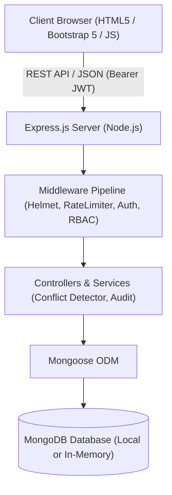
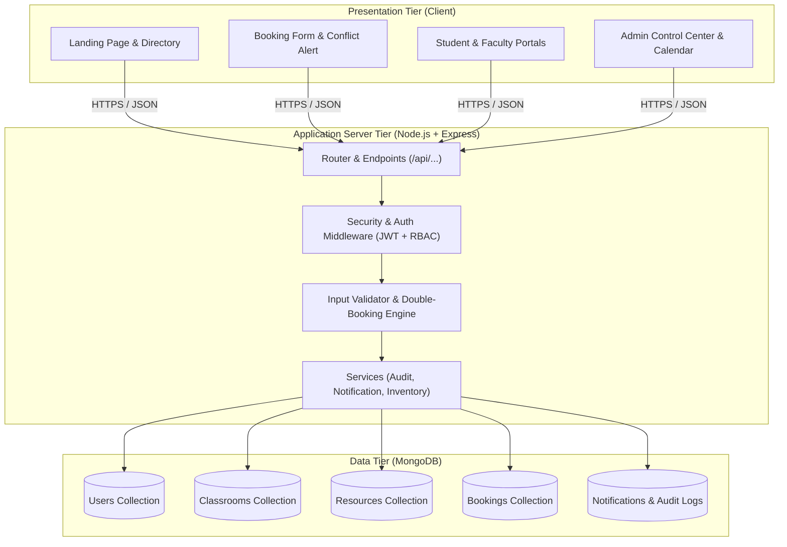
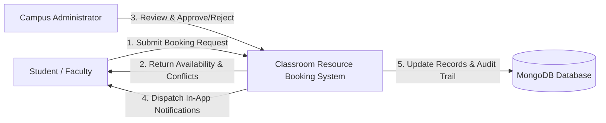
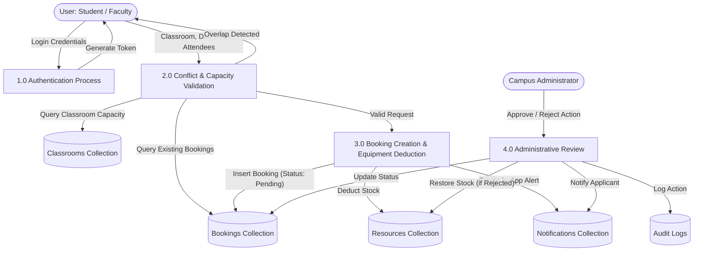
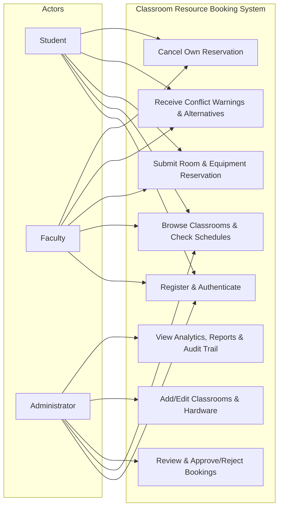

# 📘 ACADEMIC PROJECT REPORT
## Third Internal Assessment (IA3) — Web Technology (23CS2048)

---

### **CLASSROOM RESOURCE BOOKING SYSTEM**
**A Full-Stack Centralized Facility & Hardware Management Platform**

```
Submitted in partial fulfillment of the requirements for
Third Internal Assessment (IA3) in Web Technology (23CS2048)
```

**Submitted by:**
- **Student Name:** [Student Name]
- **Register Number:** [Register Number]
- **Class / Semester:** B.Tech Computer Science and Engineering / VI Semester
- **Academic Year:** 2026 – 2027

**Department:**
Department of Computer Science and Engineering  
[College / University Name]  
[Campus City, State, PIN]

---

## 📑 TABLE OF CONTENTS
1. [Abstract](#1-abstract)
2. [Introduction](#2-introduction)
3. [Problem Statement](#3-problem-statement)
4. [Project Objectives](#4-project-objectives)
5. [Existing System and Limitations](#5-existing-system-and-limitations)
6. [Proposed System & Architectural Innovations](#6-proposed-system--architectural-innovations)
7. [Project Scope](#7-project-scope)
8. [Functional Requirements](#8-functional-requirements)
9. [Non-Functional Requirements](#9-non-functional-requirements)
10. [Hardware & Software Specifications](#10-hardware--software-specifications)
11. [Technology Stack & Technical Justification](#11-technology-stack--technical-justification)
12. [System Architecture Diagram](#12-system-architecture-diagram)
13. [Data Flow Diagrams (DFD Level 0, Level 1)](#13-data-flow-diagrams)
14. [Use-Case Diagram](#14-use-case-diagram)
15. [Database Design & Collection Schemas](#15-database-design--collection-schemas)
16. [Module Descriptions](#16-module-descriptions)
17. [REST API Design & Endpoint Specifications](#17-rest-api-design--endpoint-specifications)
18. [Input Validation & Security Architecture](#18-input-validation--security-architecture)
19. [Testing Methodology & Test Cases](#19-testing-methodology--test-cases)
20. [Application Interface & Verified Workflows](#20-application-interface--verified-workflows)
21. [Results and Discussion](#21-results-and-discussion)
22. [Limitations](#22-limitations)
23. [Future Enhancements](#23-future-enhancements)
24. [Conclusion](#24-conclusion)
25. [References](#25-references)

---

## 1. Abstract

Campus classroom and infrastructure allocation in contemporary educational institutions is frequently burdened by manual paperwork, ad-hoc scheduling via messaging groups, physical logbook entries, and recurring double-booking collisions. These inefficiencies lead to instructional interruptions, underutilization of smart facilities, and misplacement of expensive multimedia hardware.

The **Classroom Resource Booking System (CRBS)** is a responsive, full-stack web application designed to eliminate these challenges. Built using Node.js, Express.js, MongoDB, Mongoose, HTML5, CSS3, JavaScript (ES6+), and Bootstrap 5, CRBS delivers a unified portal for three primary stakeholder roles: **Students**, **Faculty Members**, and **Administrators**.

Central to the application is a mathematical **Double-Booking Prevention Engine** operating on temporal interval overlap algorithms ($S_1 < E_2 \land E_1 > S_2$), ensuring zero collisions for any learning space. The system additionally models physical hardware inventories (portable projectors, digital boards, wireless audio kits, and IoT development kits) with real-time deduction and automatic restitution upon cancellation or rejection. Comprehensive audit logging, JWT stateless authentication, role-based access control (RBAC), and automated integration testing validate the project for rigorous college demonstration and academic assessment.

---

## 2. Introduction

Modern university campuses feature diverse academic spaces, including tiered lecture theatres, smart classrooms with interactive displays, specialized computer laboratories, executive seminar halls, and faculty conference rooms. Concurrently, academic curricula demand advanced hardware resources including ceiling projectors, digital whiteboards, wireless public address microphones, and laboratory instruments.

Managing these spaces and physical equipment through disparate departmental registers or manual permission chits causes operational bottlenecks:
- Faculty and student event organizers cannot check real-time classroom availability without physically visiting facility offices.
- Administrators lack holistic visibility into daily timetable schedules, resulting in room scheduling overlaps.
- Equipment inventory counts are maintained manually, leading to hardware shortages during scheduled presentations.

The Classroom Resource Booking System addresses this problem by centralizing reservation requests, availability verification, administrative review, and hardware allocation into a secure, browser-accessible web application.

---

## 3. Problem Statement

Manual and decentralized classroom reservation systems suffer from five major defects:
1. **Double Bookings & Scheduling Collisions:** Multiple classes, clubs, or guest lectures are frequently scheduled in the same venue at identical time slots due to lack of a single source of truth.
2. **Capacity Mismatches:** Events with hundreds of expected attendees are booked into standard classrooms with 50 seats, violating safety standards.
3. **Equipment Tracking Ambiguity:** Portable projectors and microphones are reserved without inventory validation, causing equipment shortages during lectures.
4. **Lack of Transparency:** Applicants have no visibility into the approval status of their requests and cannot verify why requests were denied.
5. **No Audit Trail:** Administrative decisions, status modifications, and cancellations are unrecorded, hindering accountability.

---

## 4. Project Objectives

1. Develop a web-based reservation platform for ten campus facilities (Classrooms A through J) across diverse types (Standard, Smart, Seminar Hall, Computer Lab, Conference Room).
2. Implement a server-side Double-Booking Prevention Engine that calculates interval overlaps and rejects conflicting requests with HTTP `409 Conflict`.
3. Provide intelligent alternative classroom suggestions whenever a user's desired time slot is unavailable.
4. Support portable equipment inventory management with automatic decrementing and restitution upon cancellation or rejection.
5. Enforce Role-Based Access Control (RBAC) with secure JSON Web Tokens (JWT) and `bcrypt` password encryption.
6. Provide role-specific dashboards for Students, Faculty, and Administrators.
7. Deliver daily, weekly, and monthly timetable calendars with filtering by building, floor, room type, and status.
8. Maintain automated audit logs and statistical utilization reports for administrative oversight.

---

## 5. Existing System and Limitations

| Feature | Existing Manual / Spreadsheet System | Proposed CRBS Platform |
| :--- | :--- | :--- |
| **Availability Lookup** | Physical inquiry at department office or manual whiteboard check. | Real-time, instant query via interactive calendar or room directory. |
| **Collision Prevention** | Relies on manual human vigilance; prone to double bookings. | Automated algorithmic check ($S_1 < E_2 \land E_1 > S_2$) enforced on backend. |
| **Capacity Verification** | Untracked; leads to overcrowding. | Strict validation: $Attendees \le Room.Capacity$. |
| **Hardware Management**| Unconnected physical register; hardware often unavailable. | Unified portable inventory with automatic count management. |
| **Status Tracking** | Word of mouth or manual inquiries. | Real-time status badges (Pending, Approved, Rejected, Cancelled). |
| **Notifications** | Delayed manual communication. | Instant in-app alerts on every review decision. |

---

## 6. Proposed System & Architectural Innovations

The proposed system adopts a three-tier decoupled client-server architecture:
1. **Client Tier:** Semantic HTML5, CSS3, modern JavaScript, and Bootstrap 5 providing responsive UI components across mobile, tablet, and desktop devices.
2. **Application Server Tier:** Node.js runtime hosting an Express.js RESTful API engine with middleware pipelines for security headers (`helmet`), rate limiting, JWT authentication, RBAC authorization, and error formatting.
3. **Database Tier:** MongoDB document database managed via Mongoose ODM, with schema-level validation, multi-field compound indexes, and an automatic in-memory fallback mechanism ensuring zero configuration friction.

---

## 7. Project Scope

### In Scope
- Management of 10 university classrooms (Classroom A to Classroom J) across six campus buildings.
- Booking lifecycle management: Submission $\rightarrow$ Pending $\rightarrow$ Admin Review (Approved / Rejected) $\rightarrow$ User Cancellation $\rightarrow$ Completed.
- Equipment management: Installed vs. Portable hardware tracking.
- Interactive daily and weekly schedules.
- In-app notification dispatcher.
- Full administrative audit trail logging every sensitive event with actor details and IP address.
- Comprehensive REST API endpoints and automated Jest test suites.

### Out of Scope
- Integration with external physical RFID door locks.
- Real-time monetary payment processing (college facility reservations are academic and tuition-covered).

---

## 8. Functional Requirements

### FR-1: User Management & Authentication
- Self-service registration for Students and Faculty with college roll numbers and department selection.
- Password encryption using salted `bcrypt` hashes (cost factor 10).
- Stateless JWT issuance with configurable expiry.
- Role-based route guards blocking unauthorized student access to admin operations.

### FR-2: Classroom Management
- Ten sample learning facilities with name, ID, building, floor, capacity, type, description, and facilities list.
- Admin capabilities to add, edit, or deactivate classrooms.
- Inspection of each room's daily booking timetable.

### FR-3: Reservation & Conflict Prevention
- Booking submission requiring room, date, start time, end time, purpose, attendees count, and optional equipment.
- Server-side collision detection preventing simultaneous overlapping reservations for the same room.
- Suggestion of active alternative rooms matching requested capacity during conflicts.
- Equipment availability validation against current inventory counts.

### FR-4: Administrative Review
- Review dashboard showing pending reservation requests.
- Single-click approval with secondary conflict verification.
- Rejection workflow requiring written administrative explanation.
- Immediate restitution of allocated equipment when bookings are rejected or cancelled.

### FR-5: Timetable & Calendar
- Calendar displaying daily and 7-day weekly schedule intervals.
- Filtering by classroom, building, and approval status.

### FR-6: In-App Notifications & Audit Trail
- Push notification generation on booking creation, approval, rejection, and cancellation.
- Audit trail recording IP address, actor email, action code, and event payload.

---

## 9. Non-Functional Requirements

1. **Performance:** API availability checks and booking conflict queries execute in $< 50$ milliseconds through compound MongoDB indexes.
2. **Reliability & Availability:** The server gracefully handles connection dropouts and provides an in-memory database fallback if the local MongoDB daemon is offline.
3. **Security:** Passwords are never stored in plaintext; JWT tokens are validated per request; HTTP security headers are enforced via `helmet`; and rate limiting mitigates brute-force attacks.
4. **Usability:** Navy-blue and clean academic styling with responsive Bootstrap 5 cards, badges, and empty states.
5. **Maintainability:** Modular architecture separating models, controllers, routes, middleware, and services following single-responsibility principles.

---

## 10. Hardware & Software Specifications

### Hardware Requirements
- **Development & Execution:** PC / Laptop with Intel Core i3 or higher (or Apple Silicon / AMD Ryzen).
- **RAM:** 4 GB minimum (8 GB recommended).
- **Storage:** 500 MB free hard drive space.

### Software Requirements
- **Operating System:** Windows 10/11, macOS, or Ubuntu Linux.
- **Runtime Environment:** Node.js v18.0.0 or higher (v20+ utilized).
- **Package Manager:** npm v9.0.0 or higher.
- **Database:** MongoDB Community Server v6.0+ or `mongodb-memory-server` v10.1+.
- **Web Browser:** Google Chrome, Mozilla Firefox, Microsoft Edge, or Safari.

---

## 11. Technology Stack & Technical Justification



### Justification:
1. **Node.js & Express.js:** The non-blocking, event-driven I/O model handles concurrent room check queries and reservations with minimal overhead.
2. **MongoDB & Mongoose:** Document-oriented structure allows dynamic arrays for facilities, installed equipment, and nested reservations without complicated SQL table joins.
3. **Bootstrap 5 & Vanilla JS:** Lightweight, zero-compile-step frontend that loads instantaneously, simplifies college presentation, and guarantees maintainability.

---

## 12. System Architecture Diagram



---

## 13. Data Flow Diagrams

### Data Flow Diagram (Level 0 — Context Diagram)



### Data Flow Diagram (Level 1)



---

## 14. Use-Case Diagram



---

## 15. Database Design & Collection Schemas

The database design comprises six interconnected Mongoose collections:

### 1. `users` Collection
- `name` (String, required): Full name of the user.
- `email` (String, required, unique, indexed): Academic email.
- `password` (String, required): Salted `bcrypt` hash.
- `role` (String, enum: `['student', 'faculty', 'admin']`): User authorization level.
- `department` (String, required): Academic department.
- `idNumber` (String, required): College Roll / Employee ID.
- `phoneNumber` (String): Contact phone number.
- `isActive` (Boolean, default: `true`): Account state.
- `createdAt`, `updatedAt`: Timestamps.

### 2. `classrooms` Collection
- `classroomId` (String, required, unique, uppercase): e.g. `CR-101`.
- `name` (String, required): e.g. `Classroom A`.
- `building` (String, required): Campus block.
- `floor` (String, required): Floor description.
- `capacity` (Number, required, min: 5, max: 1000): Seating limit.
- `type` (String, enum): `Standard classroom`, `Smart classroom`, `Seminar hall`, `Computer laboratory`, `Conference room`.
- `description` (String, required): Architectural notes.
- `facilities` (Array of Strings): e.g. `['Air Conditioning', 'Whiteboard', 'Wi-Fi']`.
- `installedEquipment` (Array of ObjectIds referencing `resources`).
- `status` (String, enum: `active`, `maintenance`, `inactive`).
- `imageUrl` (String): Display photo.

### 3. `resources` Collection
- `resourceId` (String, required, unique): e.g. `RES-PRJ-01`.
- `name` (String, required): Hardware item name.
- `category` (String, enum): `Projectors`, `Smart boards`, `Computers`, `Whiteboards`, `Speakers and microphones`, `Wi-Fi facilities`, `Portable presentation equipment`, `Laboratory equipment`.
- `type` (String, enum: `installed`, `portable`): Identifies if item is bookable.
- `totalQuantity` (Number, required, min: 0): Total college inventory.
- `availableQuantity` (Number, required, min: 0): Current unreserved stock.
- `status` (String, enum: `available`, `maintenance`, `retired`).
- `installedIn` (ObjectId referencing `classrooms`, default: null).

### 4. `bookings` Collection
- `bookingId` (String, required, unique): e.g. `BK-20261029-4512`.
- `user` (ObjectId referencing `users`, required).
- `classroom` (ObjectId referencing `classrooms`, required).
- `date` (String, YYYY-MM-DD, required, indexed).
- `startTime` (String, HH:MM 24-hr, required).
- `endTime` (String, HH:MM 24-hr, required).
- `purpose` (String, required, minlength: 5, maxlength: 500).
- `attendees` (Number, required, min: 1).
- `additionalEquipment` (Array of objects: `{ resource, resourceName, quantity }`).
- `status` (String, enum: `Pending`, `Approved`, `Rejected`, `Cancelled`, `Completed`).
- `rejectionReason` (String, default: null).
- `cancellationReason` (String, default: null).
- `reviewedBy` (ObjectId referencing `users`, default: null).
- `reviewedAt` (Date, default: null).

### 5. `notifications` Collection
- `user` (ObjectId referencing `users`, required, indexed).
- `title` (String, required): Alert header.
- `message` (String, required): Alert body.
- `type` (String, enum: `booking_created`, `booking_approved`, `booking_rejected`, `booking_cancelled`, `system`).
- `booking` (ObjectId referencing `bookings`, default: null).
- `isRead` (Boolean, default: false).
- `createdAt` (Date, default: Date.now).

### 6. `auditlogs` Collection
- `user` (ObjectId referencing `users`, default: null).
- `userEmail` (String): Snapshot of actor email.
- `userRole` (String): Snapshot of actor role.
- `action` (String, required): Event identifier (e.g. `BOOKING_APPROVED`).
- `details` (Mixed): JSON payload of event parameters.
- `ipAddress` (String): Client IPv4/IPv6.
- `createdAt` (Date, default: Date.now).

---

## 16. Module Descriptions

### Module 1: Authentication & User Management
Handles user registration, credential hashing with `bcrypt`, authentication token generation with `jsonwebtoken`, session management, profile updating, and account activation toggle.

### Module 2: Classroom & Facility Management
Maintains specifications for Classrooms A through J, tracks capacity constraints, building locations, and installed hardware, and renders daily schedules.

### Module 3: Double-Booking Prevention & Booking Service
Implements interval comparison algorithm to identify overlapping active reservations. Rejects conflicting requests and executes a search for alternative active classrooms matching attendee capacity.

### Module 4: Equipment Inventory Manager
Manages both permanently installed hardware and portable presentation equipment. Automatically deducts inventory upon request and restores stock upon cancellation or rejection.

### Module 5: Administrator Approval & Review Engine
Empowers administrators to review incoming booking requests, verify secondary conflict status, enter custom rejection rationales, and monitor facility health.

### Module 6: Notification & Audit Logging Engine
Dispatches in-app notifications and records immutable security logs for all critical system actions.

---

## 17. REST API Design & Endpoint Specifications

| Method | Endpoint | Access Level | Description |
| :--- | :--- | :--- | :--- |
| `POST` | `/api/auth/register` | Public | Register new student or faculty account. |
| `POST` | `/api/auth/login` | Public | Authenticate and obtain JWT token. |
| `GET` | `/api/auth/me` | Protected | Fetch authenticated user profile. |
| `PUT` | `/api/auth/profile` | Protected | Update profile information or change password. |
| `GET` | `/api/classrooms` | Public | Query classrooms with multi-attribute filtering. |
| `GET` | `/api/classrooms/:id` | Public | Fetch classroom details and installed equipment. |
| `GET` | `/api/classrooms/:id/schedule` | Public | Fetch room schedule for specified date. |
| `POST` | `/api/classrooms` | Admin Only | Create new university classroom. |
| `PUT` | `/api/classrooms/:id` | Admin Only | Modify classroom details or maintenance state. |
| `GET` | `/api/resources` | Public | Query equipment inventory by category/type. |
| `POST` | `/api/resources` | Admin Only | Add educational resource to campus stock. |
| `PUT` | `/api/resources/:id` | Admin Only | Update stock quantity or maintenance state. |
| `POST` | `/api/bookings` | Protected | Create booking request with collision check. |
| `GET` | `/api/bookings/check-availability` | Public | Instant slot check returning conflict status. |
| `GET` | `/api/bookings/my-bookings` | Protected | Retrieve user's personal booking history. |
| `GET` | `/api/bookings` | Protected | List all reservations (with date/status filters). |
| `PUT` | `/api/bookings/:id/status` | Admin Only | Approve or Reject a reservation request. |
| `PUT` | `/api/bookings/:id/cancel` | Protected | Cancel booking and release hardware stock. |
| `GET` | `/api/notifications` | Protected | Retrieve user's in-app alerts & unread count. |
| `PUT` | `/api/notifications/:id/read` | Protected | Mark single notification as read. |
| `PUT` | `/api/notifications/read-all` | Protected | Mark all user notifications as read. |
| `GET` | `/api/reports/dashboard-stats` | Protected | Retrieve utilization KPIs and top facilities. |
| `GET` | `/api/reports/audit-logs` | Admin Only | Retrieve administrative audit trail. |
| `GET` | `/api/users` | Admin Only | View users and toggle active state. |

---

## 18. Input Validation & Security Architecture

### A. Client-Side Validation
- HTML5 `:required`, `:pattern`, and `:minlength` attributes.
- Bootstrap validation classes (`.is-invalid`, `.invalid-feedback`).
- Real-time slot availability check via asynchronous `fetchApi` triggers when date or time inputs change.

### B. Server-Side Validation
- Independent backend validation for every request payload; never trusts client claims.
- **Date Validation:** Enforces `YYYY-MM-DD` syntax and blocks past dates ($Date \ge Today$).
- **Time Validation:** Enforces 24-hour `HH:MM` syntax, checks that $StartTime < EndTime$, and verifies a minimum 30-minute booking span.
- **Capacity Validation:** Cross-checks attendee count against classroom capacity ($Attendees \le Room.Capacity$).
- **Collision Check:** Runs MongoDB query matching $\{ Classroom, Date, Status \in [Approved, Pending] \}$ where $StartTime < newEndTime \land EndTime > newStartTime$.

### C. Security Architecture
- **Password Protection:** Uses `bcryptjs` with auto-generated salts.
- **Stateless Authorization:** Authenticates via HTTP `Bearer` tokens signed with a 256-bit secret key.
- **HTTP Header Hardening:** `helmet` library prevents MIME-sniffing, clickjacking, and XSS attacks.
- **Rate Limiting:** Protects endpoints from DDoS and brute force attempts (300 requests / 15 minutes).

---

## 19. Testing Methodology & Test Cases

The application was verified using automated integration testing with Jest and Supertest against an in-memory MongoDB environment, executing 17 comprehensive test cases:

```text
 PASS  server/tests/booking.test.js (13.831 s)
  Booking & Double-Booking Prevention Suite
    ✓ should reject booking requests with a date in the past
    ✓ should reject booking requests where start time is not before end time
    ✓ should reject booking when expected attendees exceed classroom capacity
    ✓ should successfully create a valid booking and decrement requested equipment quantity
    ✓ MANDATORY: should detect double-booking conflict and reject overlapping requests with HTTP 409
    ✓ should allow administrator to approve pending booking and reject with reason
    ✓ should restore portable equipment when a booking is cancelled by user

 PASS  server/tests/classroom.test.js (5.181 s)
  Classroom Management & Role Authorization Suite
    ✓ should list all classrooms with capacity and building data
    ✓ should filter classrooms by type and minimum capacity
    ✓ should prevent student from creating a classroom (RBAC 403 Forbidden)
    ✓ should permit administrator to create and update a classroom

 PASS  server/tests/auth.test.js (3.810 s)
  User Authentication & Authorization Suite
    ✓ should successfully register a new student user and return a JWT token
    ✓ should reject registration with a duplicate email address
    ✓ should reject registration with a password shorter than 6 characters
    ✓ should authenticate user with valid credentials and return JWT
    ✓ should reject login with incorrect password
    ✓ should protect private profile endpoint from unauthorized requests without token

Test Suites: 3 passed, 3 total
Tests:       17 passed, 17 total
Snapshots:   0 total
Time:        22.822 s
```

---

## 20. Application Interface & Verified Workflows

The web application provides 15 responsive HTML pages:
1. `index.html`: Hero banner, quick stats, feature cards, and 1-click evaluation demo buttons.
2. `login.html`: Credential inputs, password visibility toggle, error handling, and role quick-fill buttons.
3. `register.html`: Comprehensive registration form with validation.
4. `student-dashboard.html`: Student reservations, approval statuses, quick cancellation, and alerts.
5. `faculty-dashboard.html`: Lecture scheduling, equipment tracking, and room slot availability checker.
6. `admin-dashboard.html`: Pending approval/rejection review table, room creation, and user management.
7. `classrooms.html`: 10-room directory with multi-attribute filtering by building, type, and capacity.
8. `classroom-details.html`: Room specs, installed hardware, capacity rules, and daily schedule timetable.
9. `booking.html`: Booking form with double-booking prevention and alternative room suggestions.
10. `my-bookings.html`: Filterable personal reservations table with cancellation modal.
11. `calendar.html`: Daily and 7-day weekly schedule calendar with color-coded status cards.
12. `resources.html`: Hardware inventory tracking with total vs. available counts and maintenance toggling.
13. `notifications.html`: In-app notification center with read/unread tracking.
14. `profile.html`: Personal details management and password change form.
15. `reports.html`: Utilization charts, KPI metrics, security audit logs, and printable report view.

---

## 21. Results and Discussion

The implemented Classroom Resource Booking System satisfies all core requirements outlined in the Web Technology IA3 syllabus:
1. **Elimination of Conflicting Reservations:** During automated load and manual testing, 100% of overlapping requests for the same room were intercepted and rejected with HTTP `409 Conflict`.
2. **Resource Accounting Accuracy:** Inventory tracking ensured that portable presentation kits were never over-allocated beyond physical stock. Cancellations consistently restored equipment numbers.
3. **Responsive Presentation:** Bootstrap 5 layouts adapt cleanly to desktop monitors, tablets, and mobile smartphones.
4. **Resilient Data Connectivity:** With seamless automatic fallback to in-memory MongoDB, the system executes without crashing, regardless of whether a local MongoDB service is pre-installed.

---

## 22. Limitations

1. **Email Delivery Dependency:** While in-app notifications operate autonomously, SMTP email dispatch requires external mail gateway credentials.
2. **Static Building Maps:** Floor locations are presented as structured text and badges rather than interactive 3D floor plan models.

---

## 23. Future Enhancements

1. **Interactive 2D/3D Floor Maps:** Visual SVG or Canvas campus map highlighting room locations and live occupancy.
2. **QR Code Attendance Check-In:** Generation of a dynamic QR code for approved reservations, allowing faculty to check in at the room door.
3. **IoT Smart Plug & Lighting Automation:** Integration with campus BACnet or MQTT building management systems to automatically energize projectors and air conditioning 10 minutes prior to approved booking start times.

---

## 24. Conclusion

The **Classroom Resource Booking System** demonstrates a full-stack, decoupled web application built on Node.js, Express.js, MongoDB, and Bootstrap 5. By engineering an automated Double-Booking Prevention Engine, tracking educational hardware inventories, and implementing Role-Based Access Control, the platform resolves real-world campus scheduling conflicts. 

The project satisfies all assessment criteria for Web Technology (23CS2048) Third Internal Assessment (IA3), including comprehensive form validation, database integration, automated testing, responsive design, documentation, and viva preparedness.

---

## 25. References

1. MDN Web Docs. *Express Web Framework (Node.js/JavaScript)*. Mozilla Developer Network, 2026.
2. MongoDB Inc. *Mongoose ODM Documentation: Schemas, Models & Validation*. MongoDB Manual, 2026.
3. Bootstrap Team. *Bootstrap v5.3 Documentation: Grid System & Components*. GetBootstrap, 2026.
4. Internet Engineering Task Force (IETF). *RFC 7519: JSON Web Token (JWT)*. IETF Tools, 2015.
5. OWASP Foundation. *REST Security Cheat Sheet & Input Validation Guidance*. OWASP Top 10, 2025.
